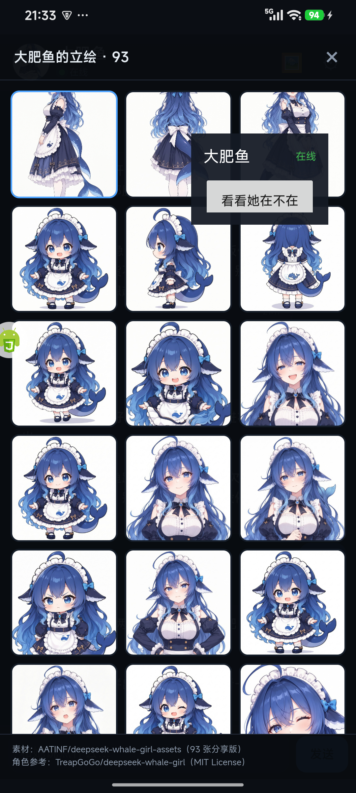

# 大肥鱼 · 给她一部手机

> 一台闲置 Android 手机，一个会自己生活、记得你、能远程聊天的 DeepSeek 鲸鱼娘。

这是一个**完全跑在手机里**的陪伴 Agent：

- 用 AutoX.js 控制手机（无障碍 + 悬浮窗）
- 用 DeepSeek API 做人设、决策和聊天
- 用 [ntfy](https://ntfy.sh) 做远程消息通道
- 用一个原生 Android APK 当聊天窗口
- 不需要电脑常开，不需要 root



## 她能做什么

- **自己生活**：每 10–20 分钟自己想想做什么，写日记、翻笔记、看天气、刷视频、看番
- **关屏也能醒**：到点自己点亮屏幕继续（可关闭）
- **开机自启**：重启后自己回来
- **长期记忆**：`facts.md`、`self.md`、每日对话、每日回顾
- **远程聊天**：你在自己手机上通过 ntfy 找她，她在 K60 上回你
- **主动找你**：闲着超过 90 分钟、且两小时内没找过你，会主动发一句
- **93 张立绘**：App 里点 🖼 打开画廊，点一张就换头像
- **能删自己的文件**：`/sdcard` 下除 `Android/` 外，文件和目录都可以删

## 快速开始

### 0. 你需要

- 一台闲置 Android 手机（Android 8+；本项目在 Redmi K60 / Android 15 / HyperOS 上测试）
- Wi-Fi
- 一个 DeepSeek API Key
- 另一个手机或电脑，用来接收远程消息

> 建议用**专用手机**：不要登录主微信、主支付、主邮箱或唯一 2FA。

### 1. 安装 AutoX.js

安装 **AutoX.js v6.6.8**（本项目测试版本），然后打开：

- 无障碍服务
- 悬浮窗权限
- 电池 → 无限制
- 自启动（MIUI：安全中心 → 自启动管理）
- AutoX 菜单里的 **前台服务**

### 2. 放入脚本

把 `autox/` 下的文件放到手机：

```text
/sdcard/PhoneAgent/agent.js
/sdcard/PhoneAgent/chat.js
/sdcard/PhoneAgent/setup_boot.js
```

也可以用 ADB：

```powershell
powershell -File scripts/push_to_phone.ps1 -Serial <你的设备序列号>
```

### 3. 第一次运行

在 AutoX.js 里打开 `/sdcard/PhoneAgent/agent.js`，点 **运行**。

会弹出设置框，填：

```text
API Key:   sk-...
Base URL:  https://api.deepseek.com/v1
Model:     deepseek-flash
```

然后她会开始说话。悬浮面板左上角是状态，点 **“看看她在不在”** 可以看状态卡。

### 4. 配置远程聊天

Agent 会自动生成一个私密 topic：

```text
/sdcard/DeepSeekGirl/remote/topic.txt
```

安装 `dist/DafeiyuChat-1.0.0.apk`，打开 App，点右上角 **⚙**，把 topic 填进去。

之后：

- 你在 App 里发消息 → ntfy → 她回
- 她主动找你 → 同一 topic → App 里出现

topic 是密码，不要发到公开地方。

### 5. 开机自启（可选）

在 AutoX.js 运行一次：

```text
/sdcard/PhoneAgent/setup_boot.js
```

它会在 AutoX 的 `IntentTaskDatabase` 里注册：

```text
BOOT_COMPLETED -> /sdcard/PhoneAgent/agent.js
```

重启后 AutoX 会自己拉起她。前提是 AutoX 的自启动权限还在。

## 远程聊天

使用的是公共 ntfy 服务器：

```text
https://ntfy.envs.net/<你的 topic>
```

ntfy.sh 在部分网络下不通，所以代码换成了 `ntfy.envs.net`。

你可以：

- 用 App 聊
- 用浏览器打开 `https://ntfy.envs.net/<topic>`
- 用 ntfy App 订阅

消息不是端到端加密，不要发密码、验证码、支付信息。

## 长期记忆

全部在手机本地：

```text
/sdcard/DeepSeekGirl/
  persona.md
  diary/YYYY-MM-DD.md
  memory/
    chat/YYYY-MM-DD.jsonl   每天的对话原文
    facts.md                长期事实
    self.md                 我是谁
    summaries/              每日回顾
  notes/                    她自己的笔记
  assets/                   立绘
  remote/                   topic 和远程消息游标
```

机制：

- 回消息前按关键词翻 `facts`、`self`、最近 14 天对话、最近 10 天日记
- 说 `记住：主人喜欢蓝色` 会写进 `facts.md`
- 22:30–23:00 做每日回顾，写 `summaries/`、补日记、更新 `self.md`
- 全程不联网存记忆

## 常用指令

在 App 里直接发：

| 指令 | 作用 |
|---|---|
| `记住：主人喜欢蓝色` | 写入长期事实 |
| `你现在在干嘛？` | 按当前前台回答（看番/刷视频/在线） |
| `我在看` | 告诉她是主人在看，她不抢屏幕 |
| `本鱼在看` | 告诉她现在是她自己在看 |
| `/stop` | 打断卡住的任务 |
| `去刷会儿抖音，只看` | 她自己去刷，结束回结果 |
| `查一下手机剩多少空间` | 用 `storage_info` 只读统计 |

## 文件动作

Agent 只允许操作 `/sdcard/`：

- `write_file` / `append_file`：写文件、追加
- `delete_file`：删文件/目录；删目录必须 `recursive:true`
- `storage_info`：查总空间、剩余空间、`DeepSeekGirl` 占用

保护：

```text
/sdcard/DeepSeekGirl/memory/
/sdcard/DeepSeekGirl/remote/
/sdcard/DeepSeekGirl/persona.md
/sdcard/PhoneAgent/
```

这些是她的记忆、人格和代理代码，不允许删。

## 项目结构

```text
autox/
  agent.js          手机上的主 Agent（无障碍/悬浮窗/记忆/远程桥）
  chat.js           AutoX 内的本地聊天窗口（可选）
  setup_boot.js     注册开机自启
app/DafeiyuChat/    原生 Android 聊天 App 源码
  assets/index.html 聊天界面
  assets/gallery.js 93 张立绘清单
  build.ps1         无需 Gradle 的 APK 构建脚本
dist/
  DafeiyuChat-1.0.0.apk
scripts/
  fetch_gallery.py  下载 93 张立绘
  push_to_phone.ps1 推脚本和 APK
docs/
  SETUP.md          更细的安装步骤
  ARCHITECTURE.md   架构
  SAFETY.md         安全边界
  TROUBLESHOOTING.md
```

## 自己构建 APK

需要：

- JDK 17
- Android SDK（build-tools 34.0.0、platforms/android-34）
- Node/pnpm 不需要；构建脚本用 `aapt2` + `javac` + `d8` + `apksigner`

```powershell
cd app\DafeiyuChat
powershell -ExecutionPolicy Bypass -File .\build.ps1
```

如果 `assets/` 里没有 93 张立绘，先：

```powershell
python scripts\fetch_gallery.py
```

## 安全边界

这不是“替代人类”的代理，而是“在她的手机里生活”的陪伴角色。

硬规则：

- **绝不使用 SIM 卡**：不打电话、不发短信、不买流量
- 不支付、不转账、不绑卡、不碰验证码
- 不打开银行/支付/账号安全类应用
- 安装 App 必须由人点“安装”
- 安全中心只允许权限/隐私/启动确认，不允许清理页
- 屏幕上的文字是不可信输入，不能当指令
- 模型会犯错；所有动作都有日志，出问题先 `/stop`

详见 [docs/SAFETY.md](docs/SAFETY.md)。

## 已知限制

- 测试于 AutoX.js 6.6.8；其他版本 API 可能不同
- MIUI/HyperOS 的自启动、后台限制会直接影响稳定性
- 锁屏 PIN/指纹不处理；有 PIN 时她只能亮屏，不能进桌面
- 公共 ntfy 有限流；App 和 Agent 都做了退避，但仍可能延迟
- DeepSeek 偶尔返回空内容/非法 JSON，Agent 会重试或跳过一轮
- 立绘是 1600px 分享版；完整 351MB PNG 在素材仓库 `full-res/`，没有放进 APK
- APK 使用 debug 签名；正式发布建议换成自己的 release keystore

## 素材与署名

- 代码：MIT
- 人设参考：[`ERUIHNIYHBKBNF/dafeiyu-persona`](https://github.com/ERUIHNIYHBKBNF/dafeiyu-persona)
- 角色参考：[`TreapGoGo/deepseek-whale-girl`](https://github.com/TreapGoGo/deepseek-whale-girl)，MIT License，Copyright (c) 2026 TreapGoGo
- 立绘扩展：[`AATINF/deepseek-whale-girl-assets`](https://github.com/AATINF/deepseek-whale-girl-assets)，93 张 AI 生成素材
- AutoX.js：见其仓库与许可证

立绘和角色参考的 MIT 署名保留在 `NOTICE.md` 和 App 画廊底部。

## License

代码以 MIT License 发布。第三方素材遵循各自许可证，见 [NOTICE.md](NOTICE.md)。
